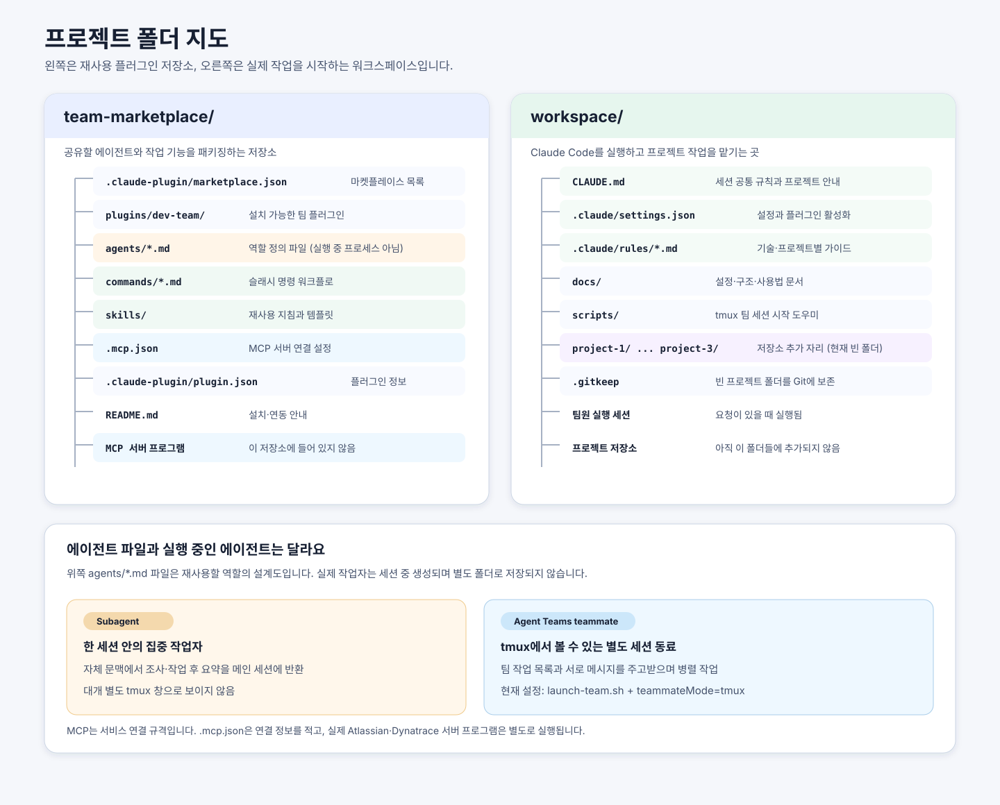

# Workspace setup and usage

## Repository layout

| Location | Purpose |
|---|---|
| `team-marketplace/` | Shared plugin: agents, commands, skills, and MCP configuration |
| `workspace/` | Team guidance, Claude Code settings, project repositories, and project-specific rules |

Run Claude Code from the workspace root so `CLAUDE.md`, `.claude/rules/`, settings, and project paths are in scope. The three project folders are onboarding slots and currently contain no repositories.



### Folder tree and ownership

```text
claude-dev-setup/
├── team-marketplace/                 # Distributable Claude Code marketplace
│   ├── .claude-plugin/marketplace.json # Marketplace catalog and plugin source
│   └── plugins/dev-team/              # Installable shared team plugin
│       ├── .claude-plugin/plugin.json  # Plugin metadata
│       ├── agents/                     # Reusable role instructions (definitions)
│       ├── commands/                   # Slash-command workflows
│       ├── skills/                     # Reusable guidance and templates
│       └── .mcp.json                   # MCP server connection configuration
└── workspace/                         # Working directory for Claude Code sessions
    ├── CLAUDE.md                      # Session-wide project map and working rules
    ├── .claude/
    │   ├── settings.json              # Workspace settings and plugin enablement
    │   └── rules/                     # General, technology, and project-specific guidance
    ├── docs/                           # Setup, usage, and structure documentation
    ├── scripts/                       # Local helper scripts (including team launcher)
    └── project-1/ ... project-3/       # Onboarding slots for actual repositories
```

`team-marketplace/` and `workspace/` have separate purposes: the former packages reusable team capabilities, while the latter supplies the instructions and settings for a working session. The `project-N/` directories are placeholders, not agent folders or server folders.

### Agent definitions and running agents

Files under `plugins/dev-team/agents/` define named plugin subagents such as `typescript-specialist` and `mr-reviewer`; they are configuration/instruction files, not continuously running processes. Claude can delegate a focused task to one of these roles as a **subagent**. A subagent runs in a separate context, returns a result to the main session, and normally does not get its own visible tmux pane.

An **Agent Teams teammate** is a separate Claude Code session coordinated by the lead, with shared tasks and peer messaging. It is created at runtime and is not represented by a dedicated folder. A teammate can use one of the named subagent definitions as its role. In this setup, `scripts/launch-team.sh` starts Claude Code in tmux, and the team commands request visible named teammates. The runtime session/panes are where teammates appear; `agents/` remains the place for reusable role definitions. The setup asks the lead not to create nested agents.

For the product's current details, see Anthropic's [subagents guide](https://code.claude.com/docs/en/sub-agents) and [Agent Teams guide](https://code.claude.com/docs/en/agent-teams).

### MCP servers

`plugins/dev-team/.mcp.json` configures external MCP server connections (currently Atlassian and Dynatrace). It is configuration for connecting to servers, not the server programs themselves. Authentication and credentials are supplied separately through supported login or environment mechanisms; do not put secret values in the file.

## Initial setup

1. Place each approved repository in `project-1/`, `project-2/`, or `project-3/`. Confirm its identity and do not copy credentials.
2. Complete the matching `.claude/rules/project-N.md` with verified owner-provided facts: Jira key, stack and versions, package manager, scripts, architecture, test setup, API/data stores, and review process.
3. Review `CLAUDE.md` and `.claude/rules/00-general.md`; resolve team choices instead of treating examples as policy.
4. Register and install the marketplace/plugin using `team-marketplace/README.md`. Keep credentials outside tracked files.
5. Configure integrations only when needed. Check current official docs for MCP endpoints/packages and Claude Code Agent Teams settings.
6. Set up the approved review CLI (`glab`, `gh`, or both) and authenticate Atlassian/Dynatrace through supported flows.
7. Verify plugin commands and path-scoped rules in a disposable session before team rollout.

## Daily use

For named, visible Agent Teams work, start a tmux-backed session with `./scripts/launch-team.sh`, then use the command prefix shown by Claude Code:

| Situation | Command |
|---|---|
| General project task | `/dev-team:team <project-N> <task>` |
| Feature implementation | `/dev-team:team-implement <project-N> <task or JIRA-KEY>` |
| Independent implementation | `/dev-team:parallel-implement <project-N> <task or JIRA-KEY>` |
| GitLab MR or GitHub PR review | `/dev-team:review-mr <number or URL>` |
| Incident analysis and drafts | `/dev-team:incident <severity> <service/environment> <time window and timezone>` |
| Jira acceptance verification | `/dev-team:verify-ticket <JIRA-KEY> [project-N]` |

If the namespace differs, use `/` to inspect available commands. Team commands require Agent Teams support and a tmux teammate mode. If unavailable, they should stop instead of claiming work was delegated.

## Working agreements

- Confirm one target project and requirements before editing. Keep work within that project and assign non-overlapping file ownership.
- Define type/API/data contracts before parallel work; use 2–4 teammates only when tasks are independent.
- Never author TypeScript `any`; keep type assertions to proven cases. For supplied OpenAPI contracts, use generated request/response types and a typed API client from the authoritative spec rather than duplicate interfaces. Respect the repository's existing generation and generated-file management policy.
- Jest unit tests default to real dependencies and wrappers; use only necessary mocks. Reused static fixture data belongs in imported `__mocks__/<fixture>.json` files. Use the existing English i18n test wrapper for translated UI.
- Maintained browser E2E uses the existing Cucumber/Gherkin + Playwright integration. Jira AC verification uses disposable tests, removes them after the run, and does not change or commit the maintained E2E suite.
- Supply `TEST_BASE_URL`, `E2E_USERNAME`, and `E2E_PASSWORD` through the project's ignored dotenv/secret loader. These variable names are the team standard. Agents consume loaded environment variables only; never open or expose `.env*` values. Missing values block E2E verification; never fall back to production.
- During React/Angular/MR review, check the technology-specific anti-pattern guides. For non-trivial algorithms and hot rendering paths, assess time/space complexity and suggest a concrete lower-cost alternative when justified by realistic workloads.
- Discover commands from project configuration. Report exact checks and outcomes; never claim unrun checks passed.
- Jira changes, MR/PR comments/approvals, customer communications, deployments, and production writes require explicit user approval.
- Customer communications are drafts only. A human verifies facts, recipients, channel, and sends.
- Project mappings, incident policy, test credentials, and project-specific commands remain unconfigured until confirmed by their owners.

## Keeping guidance current

Update the narrowest owning file when a verified convention changes: general rules in `.claude/rules/00-general.md`, technology rules in their respective files, project facts in `project-N.md`, shared roles/commands in `team-marketplace/`, and workflow in `CLAUDE.md`. Remove stale examples and keep setup docs consistent. Never document secrets.
